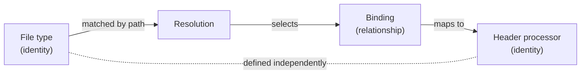

<!--
topmark:header:start

  project      : TopMark
  file         : registry.md
  file_relpath : docs/usage/commands/registry.md
  license      : MIT
  copyright    : (c) 2025 Olivier Biot

topmark:header:end
-->

# `topmark registry`

TopMark exposes a `registry` command group to inspect the three core registry domains:



## Subcommands

| Command                                                 | Purpose                                                          |
| ------------------------------------------------------- | ---------------------------------------------------------------- |
| [`topmark registry filetypes`](registry/filetypes.md)   | Inspect file type identities, matching rules, and policies.      |
| [`topmark registry processors`](registry/processors.md) | Inspect registered header processor identities and capabilities. |
| [`topmark registry bindings`](registry/bindings.md)     | Inspect effective bindings between file types and processors.    |

These commands reflect the registry split between identities (file types and processors) and
bindings, which together define how TopMark performs runtime resolution and processor dispatch.

______________________________________________________________________

## Input applicability

The `registry` command family is informational and file-agnostic. These commands inspect TopMark's
effective composed registry state and do not process project files or perform configuration
discovery.

Because registry commands do not select source-file processing targets, they do not apply
filesystem-identity normalization, processing-path selection, or processing-target eligibility
checks such as hard-link policy.

Across all `registry` subcommands:

- [`registry filetypes`](registry/filetypes.md) and [`registry processors`](registry/processors.md)
  use positional values as registry identity queries; [`registry bindings`](registry/bindings.md)
  rejects positional PATH arguments as invalid CLI usage
- `-` is not a content-STDIN sentinel
- `--stdin-filename` does not apply
- file-list STDIN modes (for example, `--files-from -`) do not apply
- `--quiet` is not supported; use output-format options for machine-readable output

Configuration discovery does not apply to registry commands.

Runtime overlays and plugin-discovered entries are still reflected in the effective registry view
exposed by these commands.

______________________________________________________________________

## Identity semantics

Registry commands expose canonical qualified identities.

Examples:

```text
topmark:python
topmark:markdown
```

TopMark may still accept local identifiers such as:

```text
python
markdown
```

in public CLI filters and configuration when unambiguous.

Registry-oriented machine-readable output and effective runtime views use canonical qualified file
type identities for deterministic registry identity handling.



See [file-type filtering](../filtering.md#file-type-filtering) for the full identifier contract.

Registry commands expose the effective composed registry view. Their output is static with respect
to project configuration: configuration discovery, file-type consent, and runtime filtering do not
affect it. This registry introspection is independent of runtime filesystem-identity evaluation for
selected processing paths.

`registry filetypes` and `registry bindings` accept `--activation {default,opt-in,never}` to filter
by a file type's declared activation. The filter is available in TEXT, Markdown, JSON, and NDJSON
output; it does not change runtime authorization.

[`registry filetypes`](registry/filetypes.md) and [`registry processors`](registry/processors.md)
also accept repeatable positional identity queries. The structured form is
`[namespace-glob]:[local-key-glob]`; either empty component means `*`. A bare identifier is an exact
local-key query, while a bare glob matches the complete qualified key. `--match-regex PATTERN` adds
a whole-qualified-identity regular-expression alternative. `--builtin` restricts results to the
reserved `topmark` namespace. These identity queries do not apply to
[`registry bindings`](registry/bindings.md).

Positional queries and `--match-regex` values are ORed. `--builtin` and `--activation` restrict the
result independently. Empty matches are successful and render an empty result in every output
format.

Compatibility: `registry filetypes` and `registry processors` previously rejected positional values.
They now interpret each positional value as an identity-query alternative. Automation that relied on
rejection of unexpected positional values should validate its invocation arguments before calling
TopMark.

______________________________________________________________________

## Shared behavior

### Exit codes

All `registry` subcommands are informational introspection commands:

- They exit with `SUCCESS (0)` on successful execution.
- Click parser errors, including invalid option values, exit with code `2`.
- TopMark-owned semantic invocation errors after parsing exit with `USAGE_ERROR (64)`.

Registry subcommands do not process project files and therefore do not use file-processing exit
codes such as `WOULD_CHANGE (3)`, `FILE_NOT_FOUND (66)`, or `IO_ERROR (74)`.

For [`registry filetypes`](registry/filetypes.md) and
[`registry processors`](registry/processors.md), positional values are identity queries rather than
filesystem paths. File-processing input options are reported as CLI usage errors.

A syntactically valid identity query, including one that matches no entries, exits with
`SUCCESS (0)`. A malformed query or `--match-regex` value is rejected by Click during parsing and
exits with code `2`.

Notes:

- Click parser-level usage errors (for example, unknown commands, unknown options, or invalid option
  values) may exit with code `2` before command logic runs.

See [`Exit codes`](../exit-codes.md) for the complete CLI-wide exit-code contract.

______________________________________________________________________

## Registry model



This diagram illustrates how file types and header processors are independent identities, while
bindings define the effective relationship used during runtime resolution and processor dispatch.

The effective runtime registry view is composed from built-in registry data plus runtime overlays.

______________________________________________________________________

## Machine-readable output

Registry commands emit canonical qualified identities in machine-readable output.

Examples include:

- `qualified_key`
- `file_type_key`
- `processor_key`

These keys are intended for stable joins, comparisons, and tooling integration.

See also:

- [Machine-readable output](../machine-output.md)
- [Machine-readable format conventions](../../dev/machine-formats.md)

______________________________________________________________________

## Related docs

- [Command overview](../cli.md)
- [Configuration](../configuration.md)
- [Filtering](../filtering.md)
- [Registry model](../../dev/registry-model.md)
- [Plugins and extensibility](../../dev/plugins.md)
- [Resolution model](../../dev/resolution.md)
- [Machine-readable output](../machine-output.md)
- [Machine-readable format conventions](../../dev/machine-formats.md)
- [Exit codes](../exit-codes.md)
- [Terminology and Canonical Vocabulary](../../terminology.md)

______________________________________________________________________

## Troubleshooting

- **Unexpected missing file type**: ensure plugin discovery completed and that the file type is
  registered in the effective composed registry.
- **Unexpected identifier form**: registry commands intentionally emit canonical qualified
  identifiers such as `topmark:python`.
- **Unexpected processor relationship**: inspect [`topmark registry bindings`](registry/bindings.md)
  to view the effective binding layer.
